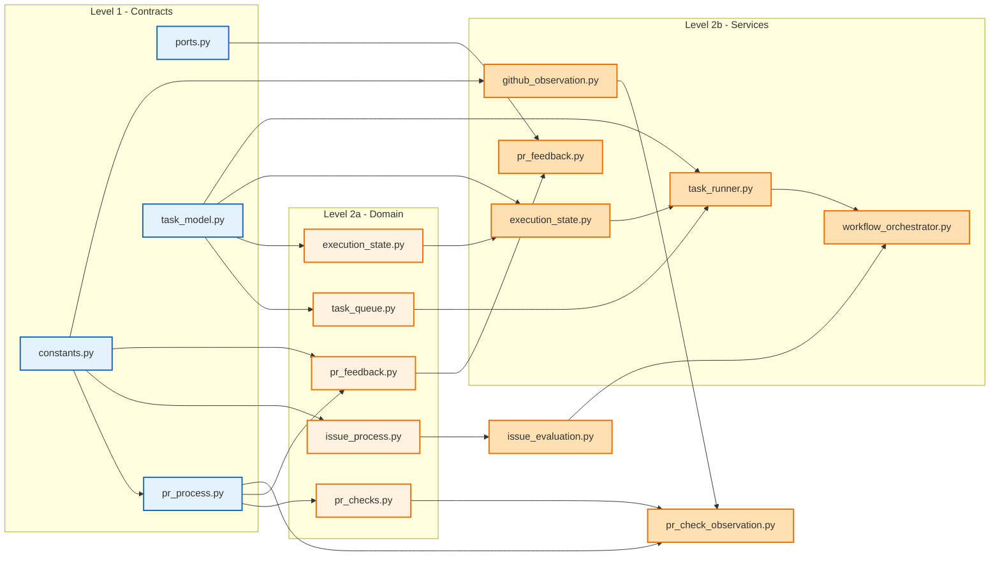

# ADR 0002: Architecture Dependency Model

> **Purpose:** The decision on how sdd4gh code is layered and which direction dependencies may point.
> **Read when:** adding a module, changing an import direction, or checking whether a dependency is allowed.
> **Owns:** the architecture levels and dependency rules, and the no-cost AI rules SN1–SN5 as decided here.

## Status

Accepted

## Context

sdd4gh follows Spec-Driven Development per [ADR 0001](0001-spec-driven-development.md). The architecture has **three layers** with strict one-way dependencies, mapping SDD to Clean Architecture:

| Level | Name | Artifacts | Responsibility |
|-------|------|-----------|----------------|
| **1** | **Contracts** | `src/sdd4gh/contracts/` | Pure data shapes, closed vocabularies and ports — no logic, no I/O |
| **2a** | **Domain Logic** | `src/sdd4gh/domain/` | Pure decision logic (issue gate, PR feedback, checks, lifecycle, trust, task queue) — no I/O |
| **2b** | **Services** | `src/sdd4gh/services/` | Orchestration and I/O (task runner, effect log, GitHub observation, model routing) — depends on 1 and 2a |
| **3** | **Verification** | `tests/` | Contract tests, unit tests, ADR-invariant tests |

The framework has no business contracts, so the types, validation and constants
sub-levels a product repository needs collapse into a single `contracts/` layer.

## Decision

### Dependency Rules

1. **Level N may only depend on Level N-1 or the same level** — never on Level N+1
2. **Contracts must not import from `domain` or `services`** — contracts are pure definitions
3. **Domain imports from contracts only** — pure logic, no I/O
4. **Services import from contracts and domain** — orchestration and I/O
5. **Tests import from all levels** — verification
6. **No cycles** — verified by automated analysis

### Layer Map

```
L1 (Contracts) ◄─── L2a (Domain) ◄─── L2b (Services)
                      │                   │
                      └───────────────────┘
                                  │
                                  ▼
                            L3 (Tests)
```

### Shared modules

Two contract modules are imported by more than one layer. They stay in
`contracts/` because every consumer sits above them:

| Module | Importers | Why it is a contract |
|---|---|---|
| `contracts/constants.py` | `contracts/pr_process`, `domain/issue_process`, `domain/pr_feedback`, `services/github_observation` | `CONFIDENCE_SHOW_BELOW`, `EVALUATION_RESULTS`, `WORKFLOW_COMMENT_MARKER` are closed vocabularies published for a consuming application |
| `contracts/ports.py` | `services/pr_feedback` | `ModelClientProtocol` is the injection port for an OpenAI-compatible client; the application supplies the implementation |

`contracts/ports.py` is named `ports`, not `types`, because a module named
`types` shadows the standard library module and mypy rejects it.

Package-relative module paths in this ADR's tables and diagrams are relative
to `src/sdd4gh/`, unless they begin with a repository-level path such as `tests/`.

## Mermaid Diagrams

### 1. Layer Architecture (Logical Dependencies)

```mermaid
graph TD
    subgraph L1["Level 1 - Contracts - Pure definitions"]
        direction TB
        C_PR["contracts/pr_process.py<br/>ADR 0006 vocabularies + shapes"]
        C_IM["contracts/issue_process.py<br/>ADR 0005 shapes"]
        C_SDD["contracts/sdd_process.py<br/>ADR 0007 shapes"]
        C_TASK["contracts/task_model.py<br/>ADR 0004 task/state shapes"]
        C_EVT["contracts/event_process.py<br/>ADR 0003 event shapes"]
        C_RETRY["contracts/retry_authorization.py<br/>ADR 0006 §5 shapes"]
        C_CONST["contracts/constants.py<br/>shared closed vocabularies"]
        C_PORTS["contracts/ports.py<br/>ModelClientProtocol"]
    end

    subgraph L2A["Level 2a - Domain Logic - Pure, no I/O"]
        direction TB
        D_ISSUE["domain/issue_process.py<br/>decide_issue"]
        D_FB["domain/pr_feedback.py<br/>evaluate_feedback"]
        D_CHECKS["domain/pr_checks.py<br/>decide_check_action"]
        D_LIFE["domain/pr_lifecycle.py"]
        D_NOTIF["domain/pr_notifications.py"]
        D_TRUST["domain/pr_trust.py"]
        D_RETRY["domain/retry_authorization.py"]
        D_QUEUE["domain/task_queue.py"]
        D_STATE["domain/execution_state.py"]
        D_EVT["domain/event_process.py"]
        D_SDD["domain/sdd_process.py"]
    end

    subgraph L2B["Level 2b - Services - Orchestration and I/O"]
        direction TB
        S_RUNNER["services/task_runner.py"]
        S_ORCH["services/workflow_orchestrator.py"]
        S_EFFECT["services/effect_log.py"]
        S_STATE["services/execution_state.py"]
        S_QUEUE["services/task_queue.py"]
        S_OBS["services/github_observation.py"]
        S_CHKOBS["services/pr_check_observation.py"]
        S_ROUTE["services/model_routing.py"]
        S_CREATE["services/pr_creation.py"]
        S_ISSUE["services/issue_evaluation.py"]
    end

    subgraph L3["Level 3 - Verification"]
        direction TB
        T_CONTRACT["tests/contracts"]
        T_UNIT["tests/unit"]
    end

    C_CONST --> C_PR
    C_TASK --> C_SDD
    C_PR --> D_CHECKS
    C_PR --> D_FB
    C_PR --> D_NOTIF
    C_CONST --> D_ISSUE
    C_CONST --> D_FB
    C_IM --> D_ISSUE
    C_TASK --> D_QUEUE
    C_TASK --> D_STATE
    C_EVT --> D_EVT
    C_RETRY --> D_RETRY

    D_ISSUE --> S_ISSUE
    D_QUEUE --> S_QUEUE
    D_QUEUE --> S_RUNNER
    D_CHECKS --> S_CHKOBS
    D_FB --> S_FB["services/pr_feedback.py"]

    C_TASK --> S_STATE
    C_TASK --> S_QUEUE
    C_TASK --> S_RUNNER
    C_PR --> S_CHKOBS
    C_PORTS --> S_FB
    C_CONST --> S_OBS

    D_STATE --> S_STATE
    S_STATE --> S_EFFECT
    S_STATE --> S_QUEUE
    S_STATE --> S_RUNNER
    S_STATE --> S_CREATE
    S_EFFECT --> S_CREATE
    S_EFFECT --> S_ISSUE
    S_QUEUE --> S_RUNNER
    S_RUNNER --> S_ORCH
    S_ISSUE --> S_ORCH
    S_OBS --> S_CHKOBS

    D_ISSUE -.-> T_UNIT
    D_FB -.-> T_UNIT
    D_QUEUE -.-> T_UNIT
    S_RUNNER -.-> T_UNIT
    S_ORCH -.-> T_UNIT
    C_PR -.-> T_CONTRACT
    C_TASK -.-> T_CONTRACT

    classDef l1 fill:#e3f2fd,stroke:#1565c0,stroke-width:2px;
    classDef l2a fill:#fff3e0,stroke:#ef6c00,stroke-width:2px;
    classDef l2b fill:#ffe0b2,stroke:#ef6c00,stroke-width:2px;
    classDef l3 fill:#fce4ec,stroke:#c21828,stroke-width:2px;

    class C_PR,C_IM,C_SDD,C_TASK,C_EVT,C_RETRY,C_CONST,C_PORTS l1;
    class D_ISSUE,D_FB,D_CHECKS,D_LIFE,D_NOTIF,D_TRUST,D_RETRY,D_QUEUE,D_STATE,D_EVT,D_SDD l2a;
    class S_RUNNER,S_ORCH,S_EFFECT,S_STATE,S_QUEUE,S_OBS,S_CHKOBS,S_ROUTE,S_CREATE,S_ISSUE,S_FB l2b;
    class T_CONTRACT,T_UNIT l3;
```



### 2. Import Graph (Verified State)

Edge counts measured over `src/sdd4gh/**/*.py`:

| From → To | Edges |
|---|---|
| contracts → contracts | 2 |
| domain → contracts | 14 |
| services → contracts | 21 |
| services → domain | 14 |
| services → services | 16 |
| contracts → domain | **0** |
| contracts → services | **0** |
| domain → services | **0** |



## Verification

### Automated Checks (Run in CI)

```bash
python3 -m mypy src/sdd4gh     # strict; rejects duplicate module names
pytest --cov=sdd4gh --cov-fail-under=80
python3 scripts/check_doc_links.py
python3 scripts/check_doc_structure.py
python3 scripts/check_traceability.py
python3 scripts/check_doc_defaults.py
```

### Dependency Rules — Verification Status

The dependency rules in the Decision section above are enforced by **code review**,
not by a mechanical check. Each row states how it is actually verified.

| Rule | Verified by |
|------|-------------|
| No import cycles | Code review. No automated cycle detection exists. |
| Contracts import nothing from domain or services | Code review. |
| Domain imports from contracts only | Code review. |
| Services import from contracts and domain | Code review. |
| Traceability of ADR → code → test | `scripts/check_traceability.py` — every module and test cites its ADR, every implemented ADR names code and a test, and Context dependencies are linked in Related. |

> **Note:** A mechanical import-graph checker would make the remaining rows enforceable rather than reviewed. That is a separate implementation concern, not a decision recorded here.

## No-Cost AI Rules (Framework-Specific)

In addition to the standard architecture, sdd4gh enforces these no-cost AI rules.
They are the subset of no-cost AI rules that binds a library with no
configuration surface of its own.

| Rule | Description | Enforcement |
|------|-------------|--------------|
| **SN1** | Default provider is local | `services/model_routing.py` defaults `provider="ollama"` and `base_url` to `http://127.0.0.1:11434/v1` |
| **SN2** | No cloud fallthrough | A routing failure or unknown model must not fall through to a paid or cloud provider; the allowlist holds local models only |
| **SN3** | No vendor SDKs | `pyproject.toml` `dependencies` is empty; the framework is standard library only |
| **SN4** | Structured output | Model responses are parsed and validated in-process; `contracts/ports.py` is the only client port |
| **SN5** | No PII to cloud endpoints | Local-first; the framework sends no session content anywhere without an injected client |

These rules are derived from Constitution S5 and S6.

## Related Files

- [ADR 0001](0001-spec-driven-development.md) — the spec-first decision
- [`docs/constitution.md`](../constitution.md) — principles S1–S8
- [`AGENTS.md`](../../AGENTS.md) — agent instructions and routing
