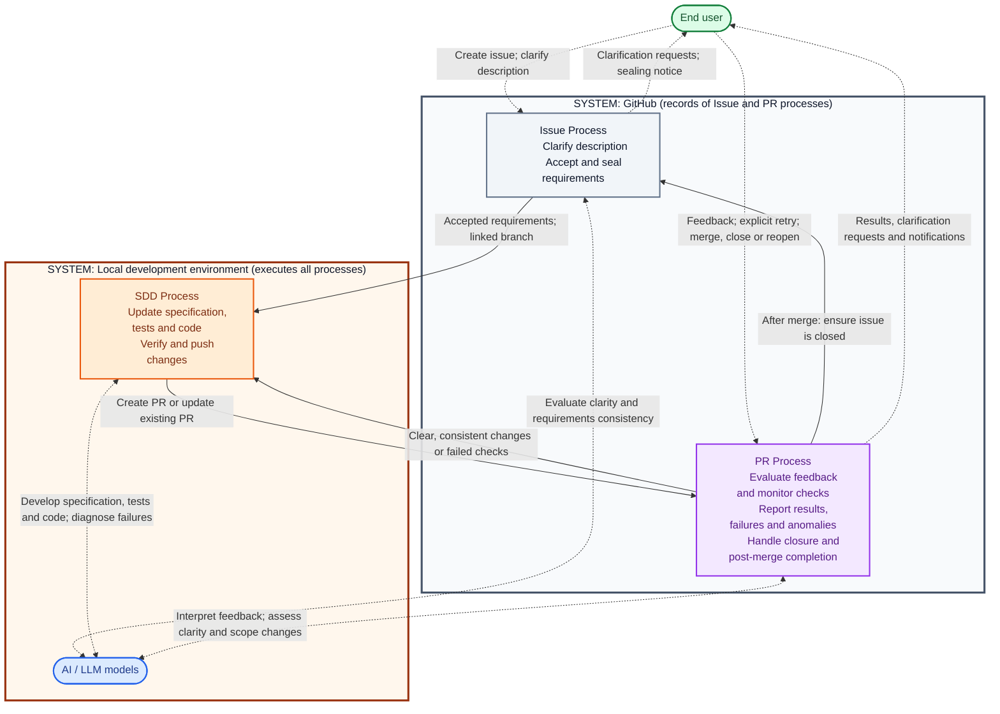

# ADR 0003: Local AI-Driven Development Workflow

> **Purpose:** The decision on the local AI-driven development workflow: its processes, handoffs and decision gate.
> **Read when:** checking how the Issue, SDD and PR processes hand off, or what the decision gate requires.
> **Owns:** the workflow model, process boundaries and the decision-gate policy. The executable step list moves to the workflow hub.

## Status

Accepted. The PR Process is specified in [ADR 0006](0006-pr-process.md); this ADR's §6 points to that current normative source.

## Context

The project needs a repeatable workflow for using a local AI model to assist with issue intake, specification-driven development, PR feedback, and completion. The workflow must preserve human control, keep requirements stable, and avoid unbounded automated correction loops.

The workflow must require no subscriptions, paid services, cloud infrastructure charges, or hardware upgrades. It must run with the existing development environment. Availability depends on that environment being running; uninterrupted operation is not assumed.

Processes, systems, and actors are distinct:

| Dimension | Elements |
| --- | --- |
| Processes | Issue: input and acceptance; SDD: development; PR: review and closure |
| Systems | GitHub; local development environment |
| Actors | End user; AI/LLM models |

The design favors clear responsibilities and user communication over automatic reactions to every possible edit.

## Decision

### 1. Process and system boundaries

Adopt three processes:

- **Issue Process:** issue intake, clarification, acceptance, sealing, and handoff to development.
- **SDD Process:** specification, tests, implementation, verification, and delivery of changes.
- **PR Process:** feedback evaluation, check monitoring, development requests, user notifications, and completion.

GitHub holds issues, PRs, comments, development links, labels, and check results. The local environment executes orchestration, monitoring, AI evaluation, development, and repository synchronization.

The system containers below show where workflow records and development work belong. Issue and PR automation does not execute inside GitHub merely because those processes are drawn there.

The human participates in Issue and PR processes, not directly in SDD. AI models participate in all three through the local environment. Future automated reviewers, such as Codex, can supply PR feedback without adding another core process.

### 2. High-level workflow

Rectangles represent processes; rounded nodes represent actors; containers represent systems. Solid arrows show process handoffs. Dashed arrows show actor interactions.

Handoff arrows are subject to the decision gate below. The closure arrow does not restart intake. Local post-merge synchronization belongs to PR Process responsibility, although it executes in the local environment.

### 3. Decision gate and communication

Consistency, transparency, and clarity apply to every AI judgment.

Every judgment authorizing an effect requires model confidence **strictly above the decision-gate threshold** (see [`CONFIDENCE_SHOW_BELOW`](../../src/sdd4gh/contracts/constants.py)). This includes acceptance, development, scope changes, closure, and other state-changing actions. Confidence at exactly the threshold does not pass.

Confidence alone is insufficient: requirements must also be clear and consistent with the constitution and other applicable non-negotiable repository rules. Deterministic checks and verification remain required.

When confidence is at or below the threshold, or requirements are unclear or inconsistent:

- Leave the affected action pending.
- Explain the uncertainty or conflict on the relevant issue or PR.
- Request clarification.
- Continue independent work only where its own conditions are satisfied.

Uncertainty notifications and clarification requests remain possible below the threshold; otherwise the system could not explain why an action is pending. Reporting failures and anomalies is also required. These communications do not authorize the withheld action.

The threshold is an execution policy, not a claim of measured correctness at the threshold value. A model's self-reported confidence is not automatically calibrated. Its assessment, evidence, and validation require implementation-level definition, anchored to observable criteria rather than the stated number alone.

### 4. Issue Process

Only open issues enter intake. Inspect GitHub Development links first, checking for an existing linked branch or PR to avoid starting duplicate development.

Prefer native issue state and development links. Use labels only for required states that native indicators cannot express.

Before acceptance:

1. The user creates or updates the description, which is the authoritative issue requirements source.
2. Local AI evaluates clarity and consistency with existing applicable requirements.
3. If evaluation does not pass the decision gate, communicate the reason through issue comments and await a description update.
4. If evaluation passes, automatically accept the issue, communicate sealing and its consequences, create and link the development branch, and hand off to SDD. No further human approval is required.

Comments are communication; they do not replace the description during issue clarification.

**Sealing is a convention, not a technical mechanism.** There is no technical mechanism that actually seals a GitHub issue or prevents its description from being edited. "Sealed" is a conceptual convention describing the point at which the issue has been accepted for development and its requirements baseline established.

- The accepted issue description becomes the requirements baseline.
- The development branch link is an observable indication that the issue has entered development.
- The branch link is a consequence of acceptance, not the technical mechanism or authoritative event that seals the issue.
- Subsequent edits to the GitHub description do not silently replace the accepted requirements baseline.

At development start, retain the accepted description as the requirements baseline and provide it to SDD. Issue Process remains responsible for monitoring and handling subsequent description edits, including after PR creation. Such edits do not silently change the sealed baseline or automatically cancel or restart development.

The sealing notice explains:

- Later description edits do not by themselves change the accepted development scope.
- Issue Process evaluates subsequent edits and communicates their effect. Any proposed scope evolution must be handled through the agreed PR feedback path and recorded in traceable specification updates.
- To replace the original development request, the user interrupts development, closes any existing PR, and deletes the development branch.
- Preferably, the user closes the original issue as not implemented and manually creates a replacement issue.
- Replacement issue creation and cancellation cleanup are not automatically triggered by description edits.

Sealing does not prohibit later scope evolution through the agreed PR feedback path. The original accepted description remains unchanged; explicit PR feedback and traceable specification updates document subsequent changes.

Closed issue status can still be inspected from PR monitoring to report inconsistencies. This does not reenter a closed issue into intake.

**Reopening a closed issue.** Reopening a previously closed issue should be treated as an anomaly, not as a request to resume or restart development.

Expected behavior:

1. Detect that a previously closed issue has been reopened.
2. Comment on the issue explaining that it was already closed and should remain closed.
3. Close the issue again, subject to the existing decision-confidence requirements (strictly above the `CONFIDENCE_SHOW_BELOW` threshold).
4. Do not revive withdrawn work, recreate branches, or resume previous development.
5. If similar or additional work is needed, the user should clone the original issue and submit it as a new issue, which goes through the normal intake and acceptance process.

This is consistent with the existing principle that closed issues do not reenter intake.

### 5. SDD Process and interfaces

Follow ADR 0001 and the repository's constitution and development rules. Do not introduce a competing SDD methodology.

The development cycle is specification, tests, implementation, and required verification. Update the relevant existing specification contracts, with references to the originating issue or PR feedback. Maintain required traceability.

| Interface | Required information or result |
| --- | --- |
| Issue to SDD | Issue reference, accepted description, linked development branch |
| PR to SDD | Existing PR and branch, relevant feedback or failed-check evidence, accepted requirements and subsequent recorded changes |
| SDD to PR: success | Verified changes, specification references, verification results, commit references; create a linked PR initially or update the existing PR |
| SDD to PR: incomplete | Failure, blocker, or uncertainty; work completed and diagnostics sufficient to inform the user |

Development and verification occur locally. PR checks provide additional verification. Passing local checks does not imply PR checks passed.

SDD does not independently merge PRs, close issues, or resolve ambiguous feedback by silently choosing an interpretation.

### 6. PR feedback

> **Current source:** [ADR 0006](0006-pr-process.md) owns the PR Process decisions. This section is a pointer; it does not retain separate PR-process rules.

PR feedback evaluation, check monitoring, bounded corrections, lifecycle, communication, and trust boundaries are defined in [ADR 0006](0006-pr-process.md). Read that ADR for the current PR Process specification.

## Consequences

### Positive

- Separates process responsibility, system execution, and actor participation.
- Provides a complete issue-to-PR lifecycle without automatic merging.
- Preserves accepted issue requirements while supporting traceable scope changes.
- Makes uncertainty, anomalies, and failures visible.
- Bounds correction loops and preserves explicit user control over retries.
- Reuses the existing SDD discipline without requiring paid services.

### Negative and limitations

- Small local models may struggle to assess requirements, perform changes, or estimate confidence reliably.
- The confidence threshold does not establish a measured correctness guarantee.
- Sealing and the convention of correcting comments by posting new ones require user discipline.
- Laptop availability limits monitoring and execution.
- Recovery, ordering, and duplicate prevention require persistent execution state and explicit implementation contracts.
- Human decisions, clarification, or retries can leave work pending indefinitely.

## Follow-up implementation specification

The architectural decisions above are sufficiently agreed for review. Before implementation, define:

1. Observable clarity and consistency criteria, confidence assessment and validation, and the decision record used before effects, including the exact description revision or comment text evaluated.
2. Exact sealed-baseline storage and branch/PR association, including ambiguous or multiple links.
3. Required local and PR checks; treatment of cancelled, skipped, infrastructure-failed, and externally blocked checks.
4. Attempt accounting when local verification fails before push; handling of feedback during an active attempt or exhausted batch.
5. Event ordering, interruption (including any GitHub-side stop signal, and a branch deleted or an issue closed before a PR exists), recovery, deduplication, and notification frequency.
6. Retry request syntax, which human or automated feedback sources are eligible, the authorization configuration, and the workflow comment marker format.
7. Safe local synchronization semantics and resumable post-merge operations.
8. Acceptance scenarios and traceability to implementation and tests.

These details must preserve the agreed policies rather than add automatic reactions to description or comment edits.

No orchestration framework, coding agent, model, or polling mechanism is selected by this ADR.

## Related

- [ADR 0001: Spec-driven development](0001-spec-driven-development.md)
- [ADR 0002: Architecture dependency model](0002-architecture-dependency-model.md)
- [ADR 0004: Worker and Task Execution Model](0004-worker-task-model.md) — how the three processes above are executed as tasks
- [ADR 0005: Issue Process](0005-issue-process.md) — elaborates §4 (intake, sealing, reopening)
- [ADR 0006: PR Process](0006-pr-process.md) — current normative source for PR-process decisions; pointed to from §6
- [ADR 0007: SDD Process](0007-sdd-process.md) — specializes §5 (the development cycle and its handoffs)
- [Project constitution](../constitution.md)
- [Workflow hub](../workflow.md) — the executable step list this ADR's model describes
