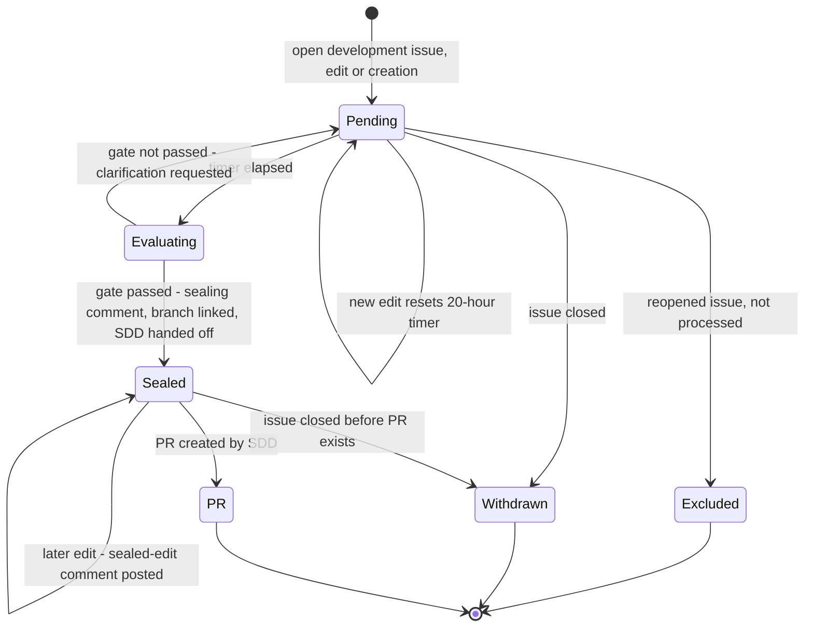

# ADR 0005: Issue Process

> **Purpose:** The decision on issue intake, evaluation, acceptance, sealing and reopening.
> **Read when:** changing how issues are evaluated, sealed or reopened.
> **Owns:** issue-process policies: triggers, evaluation, outcomes, retry, edits after sealing and withdrawal. The contracts, domain and task implementation are in [`issue_process.py`](../../src/sdd4gh/contracts/issue_process.py), [`issue_process.py`](../../src/sdd4gh/domain/issue_process.py), and [`issue_evaluation.py`](../../src/sdd4gh/services/issue_evaluation.py).

## Status

Accepted

## Context

ADR 0003 defines the Issue Process at decision level: intake, clarification, acceptance, sealing, and handoff to development. ADR 0004 defines how that process is executed as tasks on workers. This ADR records the Issue Process policies that neither of them states: what triggers evaluation, what the evaluation checks, how sealed issues react to edits, and how reopened or ambiguous issues are handled.

ADR 0003 §4 is the authoritative policy for intake and sealing. This ADR does not restate it. Where this ADR adds detail, it refines ADR 0003 and does not change it.

## Decision

### 1. Scope of intake

- Only open issues that are development requests enter intake.
- Issues labelled `exception` are excluded. They document rule exceptions and are handled outside this process.
- Issues use a template with required fields for the goal, the acceptance criteria, and a change type using the branch prefixes defined in [`docs/workflow.md`](../workflow.md). The template is the input contract for intake.
- A reopened issue is not processed. The workflow posts a comment on it saying that reopened issues are not processed.

### 2. Triggers

- No labels trigger evaluation. Labels are not used for readiness (ADR 0003 §4 allows labels only where native indicators cannot express a state).
- Each edit to a not-yet-sealed issue title or description schedules evaluation for 20 hours after that edit. Each new edit replaces the scheduled time. The wait is a not-before time on an evaluation task, as defined in ADR 0004 §4.
- Several edits within that window produce one evaluation of the latest title and description.
- The task revision hash covers both the title and description. When the scheduled evaluation runs, it evaluates the latest title and description as they stand then.

### 3. Evaluation

Evaluation checks, against observable criteria defined in the implementation specification:

- **Clarity:** a stated goal, at least one verifiable acceptance criterion, a change type, no unresolved questions or internal contradictions, and a scope that plausibly fits one PR within the 400-line limit (constitution C2).
- **Consistency:** no conflict with the constitution, the rules catalog, the specification, or the accepted ADRs.

Evaluation does not compare the issue with other issues. Issues are independent (ADR 0004 §3).

The AI identifies the branch type from the change type and the description. The identification is an AI judgment and is subject to the decision gate of ADR 0003 §3, including its confidence threshold. A missing or unclear type is a clarification request, not a guess.

Every evaluation also checks whether the issue title summarizes its description. A subjective confidence of at least 85% is sufficient to report that it fits. Below 85%, the analysis proposes a replacement title that preserves the existing style and approximate length. A title mismatch alone does not block acceptance.

For each point whose interpretation confidence is below 95%, the analysis provides a specific question with that confidence and three plausible answers (A–C), each with an evidence-based subjective confidence estimate for how well it resolves the question and clarifies the requirements. Answers are ordered from highest to lowest confidence. Option D always invites the issue author to provide another answer. These estimates are not calibrated probabilities.

If the highest-confidence answer for any question is below 95%, repeat the complete analysis using the preceding result as context. Five complete analysis attempts, including the first, are the maximum. If uncertainty remains after the fifth attempt, report the best available analysis and request clarification; do not accept or seal the issue. The analysis result is posted as a workflow-marked issue comment so it is excluded from subsequent intake.

The analysis evaluator is injected and returns validated structured output. Each refinement receives the previous structured result as data. No evaluator implementation, model, or provider is selected by this ADR.

### 4. Outcomes

**Passes the decision gate:** the issue is accepted and sealed automatically, with no further human approval (ADR 0003 §4):

1. The accepted description is recorded as the requirements baseline. The local record keeps only a hash of that accepted revision.
2. A sealing comment is posted explaining the sealing consequences defined in ADR 0003 §4.
3. The development branch is created and linked through GitHub's native development link. The branch name format follows [`docs/workflow.md`](../workflow.md): `<type>/<short-description>`, based on `main`.
4. SDD is handed off as a task.

The analysis result is posted as an issue comment before acceptance effects. The order of effects and their recovery are defined by ADR 0004 §7 and the implementation specification.

**Does not pass the decision gate, or the requirements are unclear or inconsistent:** the issue stays pending. The analysis comment explains the specific reason and requests clarification. The workflow then waits for a new description edit. Each new description revision is evaluated once, identified by its content hash. There is no limit on user clarification rounds, no reminder, and no automatic closure; the five-attempt limit applies only to refining one analysis.

There is no separate "declined" state. A pending issue that the user does not change remains pending.

**Development links are ambiguous at intake** (several linked branches or PRs, a merged PR with the issue still open, or an existing branch with an unexpected name): the workflow stops, reports the anomaly on the issue, and takes no action until the user resolves it.

### 5. Retry

After an evaluation task reaches terminal `Failed` (ADR 0004 §7), the workflow reports the failure on the issue. Recovery is manual: the user posts an explicit retry request comment. This creates a new task generation (ADR 0004 §3). Editing the description is not a retry, because the description may not have changed.

### 6. Edits after sealing

Once the issue is sealed, the sealed description remains the requirements baseline. The workflow does not re-evaluate it and does not change it.

For each new description revision after sealing, the workflow posts one comment stating that the sealed description is unchanged and that the recent edit will not be taken into account. One comment is posted per distinct new revision, identified by content hash, so repeated saves of the same text produce no further comments.

These comments are the only automatic reaction to description edits. Scope changes are handled through the PR feedback path (ADR 0003 §4 and ADR 0006 §1), not by the Issue Process.

### 7. Withdrawal and closure

- An issue closed before any PR exists withdraws its work item (ADR 0004 §7). Pending evaluation tasks become obsolete and make no effects.
- Closing an issue while a PR is open does not withdraw the work item. The PR Process handles it (ADR 0006 §3).
- Closing a pending issue cancels its scheduled evaluation.
- The Issue Process never reopens or closes an issue on its own.

### 8. Independence and concurrency

Issues do not depend on each other. Intake of one issue never waits for, compares with, or reads another issue. Concurrency follows ADR 0004 §3.

## Lifecycle

## Consequences

### Positive

- Intake is predictable: the user knows that an edit leads to evaluation after 20 hours, or to a notice if the issue is sealed.
- No labels or commands are needed for the normal path.
- Sealing is automatic once the gate passes, with no human approval step.
- Reopened and ambiguous issues cannot silently start development.

### Negative and limitations

- Evaluation latency is 20 hours after the last edit, even for a clearly complete issue. This is accepted for the MVP.
- The clarity and consistency criteria depend on a small local model and need careful definition (ADR 0003 consequences).
- Subjective confidence estimates are not calibrated correctness guarantees; repeated analysis is bounded at five attempts.
- Repeated clarification requests can leave an issue pending indefinitely if the user does not edit it.

## Follow-up implementation specification

Before implementation, define:

1. Remaining observable clarity and consistency criteria, the issue template fields, and the exact evaluated text recorded in the decision record, consistent with the structured analysis contract in §3.
2. The change type mapping to branch prefixes and the branch name format, `<type>/<short-description>` (per [`docs/workflow.md`](../workflow.md)), based on `main`.
3. The text and marker format of the analysis, clarification, sealing, sealed-edit, reopened-issue, and ambiguous-development-link comments.
4. Detection of linked branches and PRs, and the rules that make a link ambiguous.
5. The retry request syntax and the authorization rule for who may post it (ADR 0006 §5).
6. The order of acceptance effects and their reconciliation (ADR 0004 §7).
7. Acceptance scenarios: a clean pass, title mismatch, clarification analysis reaching the confidence threshold, five attempts exhausted, a gate failure followed by a fix, repeated edits within the window, edits after sealing, a reopened issue, an ambiguous link, and retry after exhaustion.

No orchestration framework, model, or polling mechanism is selected by this ADR.

## Related

- [ADR 0001: Spec-driven development](0001-spec-driven-development.md)
- [ADR 0003: Local AI-driven development workflow](../adr/0003-local-development-workflow.md) — authoritative policy for intake and sealing (§4)
- [ADR 0004: Worker and Task Execution Model](0004-worker-task-model.md) — how this process is executed as tasks on workers
- [Project constitution](../constitution.md) — C2 (400-line limit)
- [Workflow hub](../workflow.md) — branch naming convention
